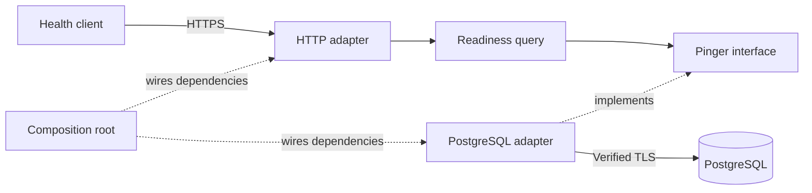

# Learning architecture while building BAO

We will develop the project in small stories and explain the design before implementing it. Each explanation connects the business requirement, Go code, data and deployment. The goal is to understand decisions and their consequences, not simply use architecture terminology.

## What the current foundation does

The composition root in cmd/bao/main.go loads configuration, connects dependencies and starts the server. It owns startup and shutdown rather than placing those responsibilities in domain objects.

The readiness query asks whether PostgreSQL responds. Its small interface is defined by the consumer. The PostgreSQL adapter satisfies that interface without the query depending on a database library. The HTTP adapter translates the query result into an HTTP response.

This demonstrates separation of responsibilities. It is not yet a business domain model or a complete CQRS implementation. Commands and aggregates will be introduced with real business rules.

The runtime call reaches the database through the injected adapter. The source-code dependency of the query points to its own interface. That distinction is the practical reason for dependency inversion.

## Learning sequence

| Step | Question to understand | Deliverable |
| --- | --- | --- |
| Domain modelling | Which rules must always hold, and who owns them? | Glossary, contexts, aggregate invariants and state diagrams |
| Commands and queries | What changes state, and what only reads it? | Use cases, contracts and read-consistency decisions |
| PostgreSQL | Which changes must commit together? | Constraints, transactions, migrations and concurrency tests |
| Events | What happens if delivery fails or repeats? | Outbox, idempotent consumers, retries and recovery diagrams |
| Security | Who can access each tenant and decrypt each record? | Authorisation model, data classification and key boundaries |
| Cloud foundations | Where do the processes and data run? | Network and deployment diagrams with trust boundaries |
| Operations | How do we detect, recover and deploy safely? | Logs, metrics, alerts, backups, rollout and recovery checks |
| Cost | What creates recurring spend? | Workload assumptions, service costs and budget controls |

## Cloud design before deployment

AWS or Azure remains a decision to make. Compare each against BAO's workload, operational effort, learning goals, data location and cost. We will use infrastructure as code once the provider and initial topology are selected.

The first cloud design must account for public HTTPS entry, application compute, private database access, workload identity, secret delivery, managed encryption keys, encrypted storage, backups and observability. Add event infrastructure when a story needs reliable asynchronous work. Do not introduce a managed service solely to populate a diagram.

Encrypting a network connection protects traffic. Encrypting a database disk protects stored media. Neither replaces tenant authorisation. Application-level encryption adds another decryption boundary for classified sensitive fields. Each requires its own design and verification evidence.

## Per story review

Before coding, explain the decision and walk through a success and a failure. Identify which parts are domain rules, application coordination, infrastructure and cloud configuration. Record unresolved product decisions. After implementation, show the code and verification that enforce the design.

Diagrams and tests make assumptions reviewable; they cannot eliminate every future change. Keep both aligned with the implementation.
