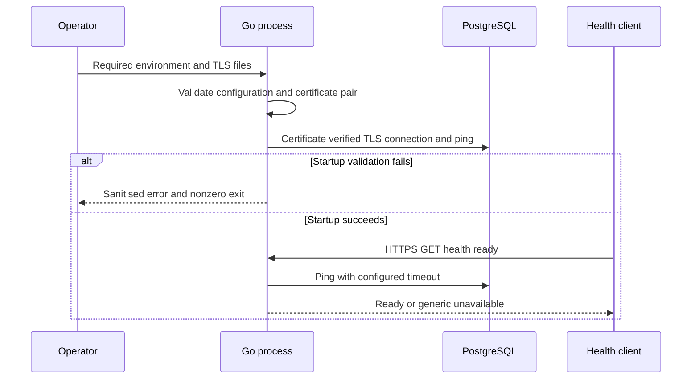

# Application foundation design

Status: Reviewed for initialisation. Business implementation and production deployment are outside this change.

Related work: GitHub issues #1, #2 and #8. This change enables those designs; it does not complete them.

## Scope and boundaries

Create an executable Go composition root, validated configuration, PostgreSQL adapter, health query handler and versioned SQL migration directory. No client data, authentication, payments, ranking or business policies are introduced. This is a bootstrap process, not a decision to deploy all bounded contexts together.

Domain code belongs in each future context's domain package. Command and query handlers belong in its application package, with infrastructure behind consumer-defined interfaces. Do not create empty aggregate or generic repository abstractions. The health query demonstrates a read path; no artificial business command is added. Migration SQL is the initial administrative write artifact.

## Runtime and security

The process accepts HTTPS only using operator-supplied certificate files. PostgreSQL must use sslmode=verify-full, with no insecure fallback. All operational values are required environment configuration with positive bounds. The application never logs the DSN, credential, certificate contents or database errors to clients. No secrets are committed.

Storage encryption, managed keys, secret injection and encrypted backups are infrastructure requirements, not guarantees made by this executable. Production release remains gated on their implementation. Application-level encryption awaits sensitive-field classification. No sensitive business fields are persisted in this change.

## Queries and failures

GET /health/live reports process availability. GET /health/ready runs a bounded database ping and returns a generic unavailable response on failure. Startup fails on invalid configuration, missing or invalid certificates, insecure PostgreSQL configuration or an unavailable database. Shutdown uses an operator-configured deadline. Health responses contain no dependency details.

## Persistence and delivery

The initial SQL migration creates the platform schema only, within a transaction. It is applied explicitly by an operator using psql with stop-on-error. A tracked migration runner, migration permissions and deployment locking must be designed before application schema evolves. No events exist yet; no broker, event sourcing or outbox is falsely represented as implemented.

## Verification

Test required configuration, invalid bounds and plaintext database rejection; test health timeout and dependency failures; compile and vet the process. An opt-in PostgreSQL integration test verifies certificate-checked connectivity against an operator-provided encrypted database. It skips if no integration DSN is supplied. No production storage encryption or backup recovery claim follows from unit tests.
